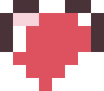
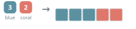
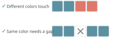
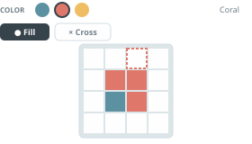

# Bettergram

🇬🇧 Bettergram is a cozy color nonogram puzzle game. Use the clues around each
board to work out which squares to fill, then uncover a small pixel-art
picture. The interface is available in English and Ukrainian.

🇺🇦 *Bettergram — затишна кольорова гра-нонограма. За підказками навколо поля
визначайте, які клітинки потрібно зафарбувати, щоб відкрити маленьке
піксельне зображення. Інтерфейс доступний англійською та українською мовами.*

## How to play / Як грати

Each puzzle has a grid with clues for every row and column. Read row clues from
left to right and column clues from top to bottom.

*У кожній головоломці є сітка з підказками для кожного рядка та стовпця.
Підказки рядків читайте зліва направо, а підказки стовпців — згори вниз.*

Each number tells you the length of a consecutive run of squares, and its
color tells you which color to use. For example, **3 blue, then 2 coral**
means three blue squares followed by two coral squares.

*Кожне число вказує довжину суцільного відрізка клітинок, а його колір —
яким кольором їх зафарбувати. Наприклад, **3 сині, потім 2 коралові** —
це три сині клітинки, за якими йдуть дві коралові.*

Runs of different colors may touch. Two runs of the same color must have at
least one empty square between them.

*Відрізки різних кольорів можуть торкатися. Між двома відрізками одного
кольору має бути щонайменше одна порожня клітинка.*

Use the row and column clues together to work out where each run belongs. Fill
the colored squares to complete the puzzle and reveal its picture.

*Зіставляйте підказки рядків і стовпців, щоб визначити розташування кожного
відрізка. Зафарбуйте всі кольорові клітинки, щоб завершити головоломку й
відкрити зображення.*

## Controls / Керування

Choose a color from the palette, select **Fill**, then click or tap a square
to color it.

*Виберіть колір на палітрі, увімкніть режим **Зафарбувати**, а потім
клацніть або торкніться клітинки, щоб зафарбувати її.*

Switch to **Cross** to mark a square as empty.

*Увімкніть режим **Хрестик**, щоб позначити порожню клітинку.*

Use **Undo** to reverse a move, **Hint** if you get stuck, or **Restart** to
start the current puzzle over. Each puzzle provides three hints.

*Скористайтеся кнопкою **Скасувати**, щоб повернути хід, кнопкою **Підказка**,
якщо ви застрягли, або кнопкою **Почати спочатку**, щоб перезапустити
головоломку. Для кожної головоломки доступні три підказки.*

Choose a picture from **Levels**. Complete a puzzle to see the finished
picture and continue to the next level.

*Виберіть зображення в розділі **Рівні**. Завершіть головоломку, щоб побачити
готове зображення та перейти до наступного рівня.*

Bettergram is designed for phones and larger screens, and can be installed as
an app in supported browsers.

*Bettergram зручно грати на телефонах і великих екранах. У браузерах, що
підтримують цю функцію, гру можна встановити як застосунок.*
